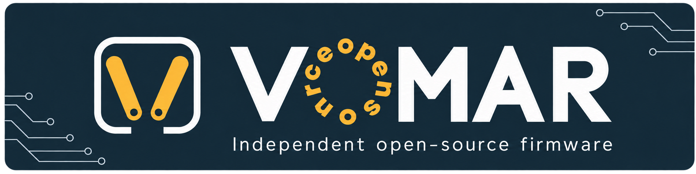

# Vomar

Vomar provides custom firmware and Android/desktop tools for compatible **Vimar
View Wireless Linea 30805** dimmers, plus a Zigbee2MQTT converter. It replaces the
nRF52840 software while retaining the original power controller. This is an
independent project, unaffiliated with Vimar.

[](https://apps.obtainium.imranr.dev/redirect?r=obtainium://app/%7B%22id%22%3A%22org.openvimar.updater%22%2C%22url%22%3A%22https%3A%2F%2Fgithub.com%2FRyther%2Fvomar%22%2C%22author%22%3A%22Ryther%22%2C%22name%22%3A%22Vomar%22%2C%22additionalSettings%22%3A%22%7B%5C%22apkFilterRegEx%5C%22%3A%5C%22%5Evomar-android-%5B0-9%5D%2B%5C%5C%5C%5C.%5B0-9%5D%2B%5C%5C%5C%5C.%5B0-9%5D%2B%5C%5C%5C%5C.apk%24%5C%22%2C%5C%22releaseTitleAsVersion%5C%22%3Atrue%2C%5C%22versionExtractionRegEx%5C%22%3A%5C%22%5C%5C%5C%5CbAndroid%5C%5C%5C%5Cs%2B%28%5B0-9%5D%2B%5C%5C%5C%5C.%5B0-9%5D%2B%5C%5C%5C%5C.%5B0-9%5D%2B%29%5C%5C%5C%5Cb%5C%22%2C%5C%22matchGroupToUse%5C%22%3A%5C%22%241%5C%22%2C%5C%22versionDetection%5C%22%3Atrue%2C%5C%22includePrereleases%5C%22%3Afalse%2C%5C%22includeDrafts%5C%22%3Afalse%2C%5C%22trackOnly%5C%22%3Afalse%7D%22%7D)

**Android:** tap the banner on your phone, review the Obtainium import, check for
updates and confirm installation. **Already using Vomar? Update over the existing
app; do not uninstall or clear its data.** [Android help](docs/android-updater.md).

**Desktop:** [download a release](https://github.com/Ryther/vomar/releases/latest)
for Linux x64, Windows x64 or macOS Apple Silicon, then follow the
[installation guide](docs/installation.md).

## Before installing device firmware

The published firmware is **experimental**. Read the exact release's known
issues and qualification record before a manual trial. Installing or updating
the Android/desktop app does not install firmware on a dimmer.

> This project includes AI-assisted code. A signature, successful CI run or
> acknowledged transfer does not establish electrical safety, working lights or
> recovery after a power cut. Keep each device's original backup privately and
> use a separately authorized qualification procedure for physical device work.

The bundle and its components have independent versions. For example, bundle
`1.0.0` contains Android `1.1.4`; Obtainium displays the **Android version**.
Release contents and known issues come from that release's `release-manifest.json`
and notes, not the version of this source checkout. See
[packages and backups](docs/offline-guide.md).

## Use Vomar

- [Install or update the app](docs/installation.md).
- [Android](docs/android-updater.md) · [Desktop GUI and CLI](docs/desktop.md).
- [Update a dimmer over Bluetooth](docs/android-bluetooth-trial.md).
- [Choose Bluetooth service or Zigbee pairing](docs/connection-modes.md).
- [Troubleshoot or recover an interrupted operation](docs/troubleshooting.md).
- [First installation on an isolated bench](docs/android-first-install.md).

[Documentation home](docs/index.md) provides the complete task-oriented guide.
Assistants can use the self-contained [Vomar user guide](.agents/skills/vomar-guide/SKILL.md).

## Develop and contribute

Start with [CONTRIBUTING.md](CONTRIBUTING.md) and the
[Dev Container guide](docs/development.md). One container includes Codex,
OpenCode, Claude and GitHub tooling; SDKs are installed only when needed.
Use synthetic fixtures and disposable services, never household credentials or
devices in automated tests.

[Architecture](docs/architecture.md), [release preparation](docs/releasing.md)
and [research evidence](docs/research-summary.md) describe the technical work.
Release Please owns bundle versions, changelogs and tags. Firmware, Android,
desktop and converter versions remain independently owned.

Source, public keys and reviewed fixtures belong in Git. Device originals,
network data, diagnostics, account credentials and private signing keys do not.
See [AGENTS.md](AGENTS.md) for workspace rules.

[MIT license](LICENSE). Dependencies retain their own
[licenses and notices](THIRD_PARTY_NOTICES.md).
